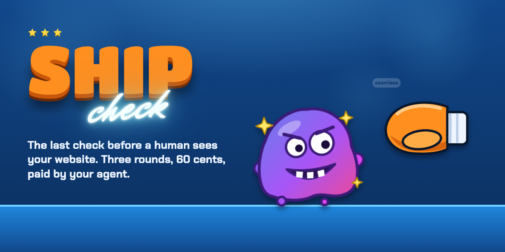
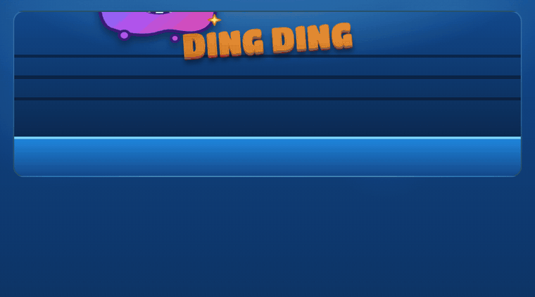
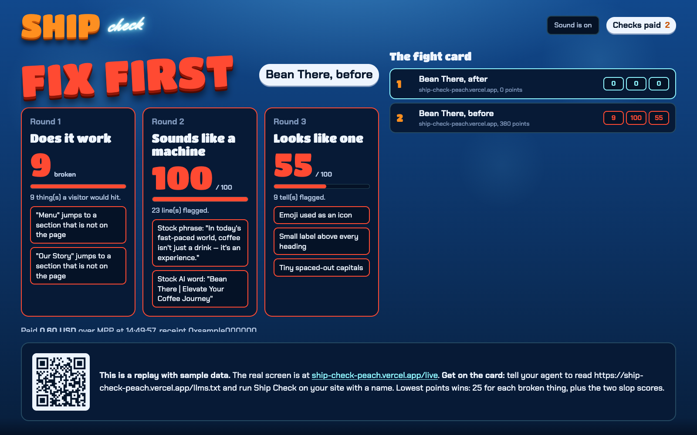

# Ship Check

**The last check before a human sees a website. An AI agent pays 60 cents and gets three rounds back.**

[](https://ship-check-peach.vercel.app)
[](https://aiwithdiego.github.io/ship-check/)
[](https://aiwithdiego.github.io/ship-check/design-system.html)
[](https://github.com/AIwithDiego/ship-check/actions/workflows/tests.yml)


[](LICENSE)

[](https://ship-check-peach.vercel.app)

Built at Agentic Dev Day Dublin (Stripe office) on 11 Nov 2026, in one afternoon session, the day after [AI Act Check](https://github.com/AIwithDiego/ai-act-check).

**[Try the real thing](https://ship-check-peach.vercel.app)** (free score in the browser, paid report for your agent, test money) · **[Open the replay](https://aiwithdiego.github.io/ship-check/)** (sample data, nothing is paid) · **[Open the design system](https://aiwithdiego.github.io/ship-check/design-system.html)** · [Run it yourself](#run-it-yourself)

**Contents:** [The problem](#the-problem) · [What it does](#what-it-does) · [The three rounds](#the-three-rounds) · [The limits we chose](#the-limits-we-chose) · [Design system](#design-system) · [What went wrong](#what-went-wrong) · [Run it yourself](#run-it-yourself) · [Credits](#credits)



## The problem

Agents build websites now, and they hand them over without looking. Two things go wrong, and the person who asked for the site finds both:

- **It does not work.** The "Book now" button goes nowhere. The menu link is a 404. The form says thanks and sends nothing. On a phone the page is the desktop page, shrunk.
- **It reads as generated.** "In today's fast-paced world, coffee isn't just a drink." A purple gradient, three matching cards, an emoji on each.

The agent that built the page has a model, so it can fix all of it. What it lacks is a judge that is not itself.

> The agent already knows how to write and how to code. It pays for the second pair of eyes.

## What it does

1. The agent deploys the page and calls `POST /score` (free): pass or fail per round, with the counts.
2. It calls `POST /check`. The server answers HTTP 402 with the price. The agent pays over Stripe's Machine Payments Protocol and retries.
3. It gets the report: every broken thing with where it is and how to fix it, every flagged line of copy quoted with the habit named, every design tell with the selector. Plus a receipt.
4. It fixes, deploys and checks again until the report says ship.

A bad address or an unreachable page is refused before the 402, so an agent never pays for a check it cannot use.

| Route | Price | What comes back |
|---|---|---|
| `POST /score` | free | `ship`, and per round: pass or fail, the score, the number of findings |
| `POST /check` | 0.60 USD over MPP | The full report and a `Payment-Receipt` header |
| `GET /live` | free | The room's screen: the last paid checks and the board |
| `GET /llms.txt`, `/openapi.json` | free | How an agent uses it |

## The three rounds

| Round | It finds | How |
|---|---|---|
| 1. Does it work | Broken links, images, scripts and stylesheets. Buttons, links and forms that go nowhere. A form that says thanks without sending. Missing title, viewport, description, language. | Reads the HTML, then asks each thing the page points at whether it is there (`src/checks.ts`) |
| 2. Does it sound like a machine | "Not X, but Y", stock words and phrases, staged openers, questions that answer themselves, "No X. No Y. Just Z.", em dashes, emoji as decoration. English and Spanish. | A rule set, one pass over the visible text (`src/slop.ts`) |
| 3. Does it look like one | Emoji as icons, three identical icon cards, the small label over every heading, the purple gradient, gradient text, the one coloured word in a headline. | The static gates of [Hallmark](https://github.com/nutlope/hallmark)'s sloplint, filtered and weighted (`src/look.ts`) |

Round 1 passes with nothing serious. Rounds 2 and 3 are a score from 0 to 100 and pass under 30.

## The limits we chose

- **Rules, no model.** The same page gets the same score. A flag that is wrong can be traced to the rule that raised it.
- **It is not an AI detector.** Those flag real people. Ship Check says "this line reads as machine-written, and here is the habit", never "a machine wrote this".
- **No browser yet.** It reads HTML and CSS. A page that is an empty shell until JavaScript runs (most React sites) is refused before payment, with the reason, instead of being scored blank. A browser in the cloud is the next step, not today's.
- **Round 3 is the roughest.** Designed sites use gradients and glass too. Those count for little alone; the cheap tells (emoji icons, the three cards, the label over every heading) carry the score.
- **Addresses from strangers.** Every request goes through one fetcher that only dials public addresses, checks the address at connect time, and checks again on every redirect (`src/fetcher.ts`).
- **The page is not stored.** The live feed keeps the last 20 scores for 24 hours. A site's address and its top three findings per round appear on the board only when the caller gives a name for it.

## Design system

Fight night: a blue ring under the lights, chunky orange block letters, one line of neon script. Tokens and parts are in [`public/ds.css`](public/ds.css), shown at `/design`. The pages pass their own three rounds, which shaped the system: no gradient text, no accent word inside a heading, no glass.



While a check runs, the glove spars with the slop monster. The monster is the only purple thing on the site, and it is drawn from what round 3 flags. A pass knocks it out. A fail leaves it standing.

## What went wrong

- **The first deploy went straight to production.** It was meant as a preview. On a new Vercel project the first deployment is assigned to production whatever you asked for.
- **stripe.com scored 82 out of 100 on "looks machine-made".** Gradients, glass and one coloured word in a headline are Stripe's own look, the one generated sites copy. The round now splits cheap tells (emoji icons, three identical cards, a label over every heading) from imitated looks, which count for little alone. Stripe scores 19.
- **A blank page got a perfect score.** A React site sends an almost empty page and fills it in with JavaScript. Ship Check read the empty page, found nothing wrong and said ship. It now refuses those pages before payment.
- **Two false alarms on round 1.** A link that did not answer our server was called broken, and a newsletter form whose request lives in a script file was called a fake. Both are now reported as things to verify.

**What I didn't build:** a browser in the cloud. Screenshots, console errors and pages drawn by JavaScript all need one. It is the first ticket after the event.

## Run it yourself

```
npm ci
npm test
cp .env.example .env    # then fill in the Stripe sandbox values
npm run dev             # http://localhost:4950
```

| Variable | What it is |
|---|---|
| `STRIPE_SECRET_KEY` | A Stripe sandbox key (`sk_test_...`) |
| `STRIPE_PROFILE_ID` | The Stripe profile that receives MPP payments |
| `TEMPO_DEPOSIT_ADDRESS` | Optional: a Tempo address, to accept stablecoin as well as card |
| `PRICE_USD` | Optional, default `0.60` (Stripe's card minimum is EUR 0.50) |
| `UPSTASH_REST_URL`, `UPSTASH_REST_TOKEN` | Optional: a shared store so `/live` works on serverless hosting |

Pay for a check with test money:

```
npx mppx@0.17.1 account create -a me && npx mppx@0.17.1 account fund -a me --network testnet
npx mppx@0.17.1 http://localhost:4950/check -X POST -H 'content-type: application/json' -d '{"url":"https://example.com"}' -a me --network testnet
```

There is a Claude Code skill in [`agent/SKILL.md`](agent/SKILL.md).

## Credits

- Round 3 runs [Hallmark](https://github.com/nutlope/hallmark)'s `sloplint.mjs` (MIT, Together AI), vendored unchanged in `vendor/hallmark` at the commit in `PINNED.txt`.
- Fonts: Titan One, Chakra Petch and Mr Dafoe (SIL Open Font License).
- Payments: [mppx](https://www.npmjs.com/package/mppx) and Stripe's Machine Payments Protocol.

MIT. By Diego Bauer, [AIwithDiego](https://aiwithdiego.com).
